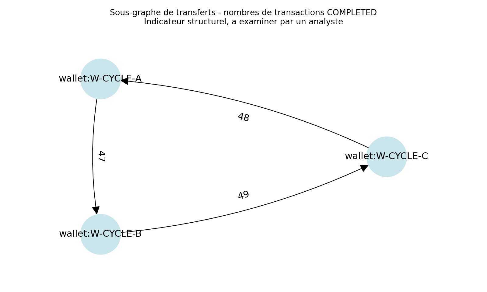

# SahlPay : plateforme analytique
Écosystème Big Data 2 - EMSI, 5ème année - Année 2026-2027

## Partie 1 - Positionnement et cluster
J'ai réalisé une preuve de concept pour SahlPay.ma, portefeuille mobile fictif. Je simule les événements de l'API Spring Boot/PostgreSQL avec un producteur Python : la chaîne analytique complète le système transactionnel, elle ne remplace pas sa base. Mon objectif est d'analyser les événements de paiement, puis de signaler des structures inhabituelles sans conclure automatiquement à la fraude.

```text
API / PostgreSQL (simule par producer.py)
         +--> historique JSONL --> MinIO Bronze --> RDD / SQL --> Silver
         +--> Kafka KRaft : transactions, 3 partitions
                         |
           Spark Master + deux Workers (standalone)
                         |
    Bronze JSON --> Silver Parquet --> Gold Delta / Parquet
                         |
               GraphFrames --> GraphX --> indicateurs
```

### Rôle des composants dans mon déploiement
Le **Driver**, lancé dans jupyter, construit les plans, ordonnance les jobs et suit leurs résultats. Le **SparkContext** représente la connexion de cette application au cluster et permet les opérations RDD. Le **Cluster Manager** est le Master standalone : il attribue les ressources proposées par les Workers. Les **Executors** démarrent sur les deux Workers ; ils exécutent les tâches, échangent les partitions du shuffle et conservent l'état ou les données en cache. Un Worker est un processus de gestion ; il ne se confond pas avec l'Executor d'une application.

J'ai alloué un cœur et 1 536 Mio par Worker, deux Executors de 768 Mio et un Driver de 1 Gio. Kafka est un broker/contrôleur KRaft unique ; MinIO héberge lake ; Jupyter fournit PySpark ; les services d'initialisation créent automatiquement le bucket et le topic. Le History Server conserve l'accès aux DAG après la fin des applications.

### Pourquoi Spark plutôt qu'un enchaînement MapReduce ?
Première limite : les écritures intermédiaires et le redémarrage de jobs MapReduce coûtent cher pour réutiliser les mêmes paiements et pour les algorithmes itératifs de graphes. Spark peut conserver les partitions en mémoire et optimiser un DAG de plusieurs opérations. Deuxième limite : le modèle principalement batch de MapReduce impose une latence peu adaptée au suivi presque temps réel ; Structured Streaming traite incrémentalement les événements Kafka. Spark peut néanmoins écrire sur disque et subir des shuffles coûteux : je ne le présente pas comme un système entièrement en mémoire.

### Vérification réellement obtenue
Le 19 novembre 2026, le Master a déclaré deux Workers ALIVE. Le contrôle a affiché Spark 3.5.3, master `spark://spark-master:7077`, appName `SahlPay - Partie 1` et `defaultParallelism=2`, puis exécuté une somme distribuée de contrôle. Je n'assimile pas defaultParallelism à un inventaire universel des cœurs. Les captures Spark Master/DAG/stages restent à ajouter par l'étudiant ; aucune image d'interface n'a été fabriquée.

<!-- pagebreak -->

# Partie 2 - RDD, DAG et lineage
J'ai exécuté `producer.py --mode file --n 50000` avec la graine 42. Les 50 000 événements ont été déposés dans `lake/bronze/history/transactions_history.jsonl`. Mon contrôle a trouvé 2 418 retards injectés (4,836 %), 992 doublons exacts (1,984 %) et un retard injecté maximal de 900 secondes. Le référentiel contient 300 commerçants. Les données et la vérité terrain restent hors Git.

### Traitement et résultats
J'ai utilisé `sc.textFile()`, `json.loads`, puis filter sur COMPLETED. Le total par ville repose sur map/reduceByKey ; la moyenne réduit des tuples (somme, nombre) en un seul passage, puis divise. Le top 5 filtre aussi P2M et utilise takeOrdered. Ces calculs suivent les événements d'entrée : les doublons ne sont supprimés qu'en Silver, à la Partie 3.

| Ville | Total MAD | Moyenne MAD |
|---|---|---|
| Agadir | 4 468 634,31 | 1 891,89 |
| Casablanca | 4 465 622,76 | 1 901,07 |
| Fes | 4 475 967,88 | 1 897,40 |
| Marrakech | 4 471 109,62 | 1 885,75 |
| Rabat | 4 437 284,13 | 1 894,66 |
| Tanger | 4 456 454,76 | 1 884,34 |

Les montants ci-dessus sont arrondis pour la lecture ; les sorties intégrales sont dans rdd_batch.txt. Mon top 5 est M-138 (66), M-002 (65), M-038 (64), M-105 (64), M-135 (64). Les égalités sont départagées par identifiant. Je compte des paiements P2M COMPLETED, sans prétendre établir un grand livre comptable.

### Transformations, actions et stages
`map`, `filter`, `reduceByKey` et `mapValues` sont des transformations lazy : elles décrivent le calcul. `collect` et `takeOrdered` sont des actions : elles déclenchent les jobs. Le total RDD par ville a pris 13,216 s, avec deux stages mesurés, identifiants 0 et 1 ; l'ensemble des calculs RDD a pris 15,542 s. Le démarrage des Executors participe à ce temps.

```text
HadoopRDD -> parsing Python -> filter COMPLETED -> map(city, amount)
                                                |
                                        combinaison locale
                                                |
                                 shuffle / partitionnement par city
                                                |
                                      reduceByKey -> collect
```

Le DAG exprime les dépendances entre partitions. reduceByKey provoque un shuffle : les valeurs d'une même ville doivent rejoindre la même partition, après une combinaison locale qui limite les échanges. Cette dépendance large sépare les stages. `toDebugString()` expose notamment ShuffledRDD dans ma sortie réelle ; les captures du DAG restent à ajouter depuis Spark UI/History Server.

Le lineage conserve les transformations nécessaires pour reconstruire une partition perdue à partir de Bronze. Cette tolérance suppose que la source reste disponible. Je l'explique comme un mécanisme de Spark ; je n'ai pas exécuté de panne de Worker et je n'en présente donc aucune mesure.

<!-- pagebreak -->

# Partie 3 - DataFrames et Spark SQL
J'ai lu les transactions et merchants.json avec deux StructType explicites, sans inférence. J'ai recalculé total et moyenne par ville avec groupBy/agg, puis avec createOrReplaceTempView et spark.sql. Pour la jointure, je retiens les événements P2M COMPLETED, je rapproche payee_id et merchant_id, puis je somme les montants par catégorie et ville de transaction.

### Plans et optimisation observés
Mon explain(True), versionné dans explain_true_jointure.txt, distingue le **plan parsé** (opérations demandées), le **plan analysé** (noms et types résolus), le **plan logique optimisé** par Catalyst et le **plan physique** exécuté. Les filtres status/type sont poussés avant la jointure ; seules les colonnes utiles du référentiel sont lues. J'ai explicitement diffusé le référentiel de 300 lignes : le plan physique contient **BroadcastHashJoin**, BuildRight, et BroadcastExchange. Je n'affirme pas qu'une jointure arbitraire serait toujours diffusée : sans ce choix, les statistiques et la configuration pourraient mener à SortMergeJoin.

Un RDD porte des objets et des fonctions générales ; Catalyst ne voit pas le sens d'une lambda Python. Un DataFrame expose un schéma et des expressions que Catalyst peut réordonner, simplifier et projeter. Un Dataset Scala ajoute un typage statique avec Encoder ; le DataFrame JVM correspond à Dataset[Row]. PySpark ne fournit pas cette même API Dataset statiquement typée. Tungsten améliore la représentation binaire/mémoire et la génération de code JVM ; il ne supprime ni réseau, ni I/O, ni conversion Python.

### UDF et expression native
J'ai écrit amount_band en UDF Python, puis avec when/otherwise : micro pour un montant inférieur à 50 MAD, standard de 50 à 2 000 inclus, eleve au-delà. L'UDF Python est opaque à Catalyst et impose des échanges/sérialisations Python-JVM ; l'expression native peut être optimisée et générée côté JVM. Je n'ai pas utilisé un simple count pour le benchmark : je collecte des agrégations sur la bande, pour forcer son calcul.

| Calcul | Temps mesuré en secondes |
|---|---|
| RDD total par ville | 13,216 |
| DataFrame total + moyenne, premier calcul | 16,465 |
| SQL total + moyenne, ensuite | 0,443 |
| UDF Python, trois passages | 1,452 / 0,363 / 0,414 |
| when/otherwise, trois passages | 0,406 / 0,272 / 0,225 |

Les deux versions de amount_band produisent les mêmes effectifs : micro 2 348, standard 24 076, eleve 23 576. Je constate ici des temps plus faibles pour when/otherwise ; je ne généralise pas un rapport de performance à partir d'un seul ordre de passage. Le cache système, le démarrage et la différence de charge total seul/total+moyenne empêchent une comparaison isolée RDD/DataFrame. Je n'ai mesuré aucun Dataset Scala pour cette requête.

### Silver et limites de modèle
J'ai nettoyé puis dédoublonné les couples tx_id/status et écrit **49 008 lignes** en Parquet dans `lake/silver/transactions_history/`, partitionné par city. Parquet permet projection de colonnes, compression et lecture analytique ; la faible cardinalité des villes limite le nombre de partitions. Les montants sont DoubleType pour l'exercice : DecimalType ou des centimes entiers seraient nécessaires pour une comptabilité exacte. Les événements REVERSED ne sont pas traités comme une annulation comptable dans cette preuve de concept.

<!-- pagebreak -->

# Partie 4 - Structured Streaming
J'ai lu Kafka avec readStream.format("kafka"), puis converti value avec from_json et le schéma explicite de la Partie 3. Je représente la source comme une **table infinie** : chaque arrivée ajoute un événement ; les transformations maintiennent une table de résultat incrémentale ; le sink publie son évolution. Les offsets propres à chaque requête sont conservés dans son checkpoint.

### Mes quatre requêtes
- La console brute utilise append : elle affiche les nouveaux événements typés.
- Bronze conserve les valeurs JSON originales avec un sink texte et un checkpoint dédié. Les fichiers .txt contiennent du JSON ligne à ligne, sans enveloppe ajoutée.
- Le comptage ville/statut utilise complete : toute la table agrégée est réaffichée.
- Une agrégation par fenêtre de dix minutes en append permet d'observer l'effet réel du watermark sur l'état temporel.

Je déclenche les micro-batches avec `trigger(processingTime="10 seconds")`. Le moteur planifie des jobs incrémentaux à chaque déclenchement ; si un batch dure plus de dix secondes, cet intervalle n'est pas une garantie de latence. Le mode continu (`trigger(continuous="1 second")`) vise une latence plus faible, avec une garantie au moins une fois et des opérations plus limitées ; je ne l'utilise pas pour ces agrégations à état.

Append écrit les nouvelles lignes qui ne changeront plus ; update écrit les lignes modifiées ; complete réécrit toute la table de résultat. Les possibilités dépendent de l'opération et du sink : un fichier append ne peut pas recevoir arbitrairement les mises à jour d'une agrégation non finalisée. En complete, les groupes ville/statut sont conservés ; un watermark posé sur un simple flux brut ne supprime pas automatiquement ses lignes.

### Exemple de quinze minutes issu de mon journal
Le producteur courant a émis **1 200 événements en 60,029 s**, soit environ 20 événements/s. Après le rejeu de l'historique, la Partie 4 a lu 51 201 événements : 50 000 historiques, ces 1 200 émissions et une sonde dédiée. Les consoles montrent plusieurs micro-batches et Bronze contient les valeurs Kafka.

```text
Emission (UTC)        : 2026-11-19 21:15:37.172460
event_time (UTC)      : 2026-11-19 21:00:37.172460
Retard exact         : 900 secondes
Watermark precedent  : 2026-11-19 21:05:17.369
Fenetre de l'evenement : [21:00, 21:10[
Batch observe        : 7 ; une ligne lue ; zero ligne rejetee par watermark
```

L'événement est plus ancien que le watermark, mais sa **fenêtre finit à 21:10**, après le watermark : elle reste ouverte, et la métrique de rejet vaut zéro. Cet exemple ne démontre donc pas un rejet automatique des événements de quinze minutes. Pour une fenêtre déjà finalisée, des données plus anciennes peuvent être exclues. La garantie du watermark protège les données suffisamment récentes ; au-delà du délai, l'acceptation n'est pas garantie. Je conserve la trace détaillée, l'offset et les métriques dans watermark_late_example.txt.

J'ai mesuré les durées de trigger et les débits rapportés par StreamingQueryProgress. Le rejeu historique est accéléré pour finaliser des fenêtres sans attendre longtemps ; il n'est pas le test à 20 événements/s. L'âge du plus récent event_time à la fin d'un batch, calculé dans stream_metrics.txt, inclut le rejeu et les retards injectés : ce n'est pas une latence de bout en bout de chaque paiement.

Sur les 33 micro-batches non vides de production Silver de référence, la durée médiane de trigger vaut **1,289 s**, le débit traité médian déclaré par Spark **178,034 lignes/s**, et l'âge médian du plus récent événement à la fin du batch **1,316 s**. Ce débit de traitement inclut le rattrapage du stock ; il diffère du débit d'émission constant de 20 événements/s. Je n'en déduis pas un débit maximal soutenable ni un percentile de latence par transaction.

<!-- pagebreak -->

# Partie 5 - Pipeline durable
J'ai appliqué `withWatermark("event_time", "10 minutes").dropDuplicates(["tx_id", "status"])`, puis une jointure gauche stream-static avec merchants et l'expression native amount_band. Les P2P restent présents avec une catégorie commerçant nulle. Je partitionne Silver Parquet par city et date UTC. Je fixe les colonnes city/date en fin de schéma pour que la relecture de la source fichiers partitionnée conserve le même ordre.

### Trois fenêtres, trois usages
| Fenêtre | Groupement et résultat |
|---|---|
| Tumbling 10 minutes | Ville ; nombre d'événements et montant total |
| Sliding 10 minutes, pas de 5 | Ville ; nombre REJECTED / nombre total |
| Session, inactivité 5 minutes | device_id ; nombre d'événements et durée |

Les tumbling ne se chevauchent pas. Un événement peut appartenir à deux fenêtres sliding successives. Une session fusionne les événements séparés par moins de cinq minutes d'inactivité ; sa durée calculée end-start inclut l'intervalle terminal porté par session_window. Les résultats en append attendent la finalisation par watermark. Les fenêtres sont basées sur event_time, pas sur l'heure de traitement.

Je compte des **événements d'état**, conformément aux colonnes du sujet. Plusieurs états d'une même transaction ne deviennent pas un seul paiement ; sommer tous leurs montants n'est pas un chiffre d'affaires. Pour un indicateur comptable, il faudrait sélectionner et consolider les états finaux, puis traiter les annulations.

### Silver comme frontière rejouable
J'ai séparé les opérations à état en plusieurs requêtes : Kafka vers le dédoublonnage/Silver ; Silver vers chacune des agrégations. Chaque sink dispose d'un chemin de checkpoint propre. Le sink fichiers de Spark publie son journal de fichiers committés ; les sources fichiers en aval relisent ce qui a été durablement publié. Je n'empile pas plusieurs opérateurs à état dans une même requête.

La forme de dropDuplicates imposée par le sujet peut garder un état non borné, car event_time n'est pas dans la clé. La métrique observée numRowsRemoved=0 le rappelle. Spark 3.5 propose dropDuplicatesWithinWatermark pour un autre compromis ; je n'ai pas substitué cette API à la consigne. Le watermark filtre aussi les données trop tardives à l'entrée des traitements concernés.

### Delta et exactly-once
Je conserve la tumbling dans `lake/gold/kpi_city_10min/` en Delta, et sliding/sessions en Parquet. Delta ajoute des transactions ACID, un journal de commits et DESCRIBE HISTORY ; Parquet seul ne fournit pas cette gestion transactionnelle de table. J'active DeltaSparkSessionExtension, DeltaCatalog et S3SingleDriverLogStore pour MinIO, avec un seul Driver écrivain par table.

L'exactly-once repose sur trois conditions : source rejouable (Kafka ou fichiers Silver), checkpoints conservés (offsets, commits et état) et sink transactionnel ou idempotent. Après un arrêt, un batch non committé peut être relu ; Delta et le journal de fichiers empêchent sa publication en double sous les mêmes identifiants de requête/checkpoint. Je ne change ni la topologie à état ni le checkpoint pendant une reprise. Un sink console ne possède pas ce commit transactionnel et peut réimprimer un batch rejoué.

Cette garantie suppose Kafka encore dans sa rétention, MinIO et les checkpoints intacts, et aucun écrivain Delta concurrent indépendant. Elle ne remplace ni la haute disponibilité du broker unique ni une politique métier pour les événements exclus par watermark.

<!-- pagebreak -->

# Partie 5 - Expérience de reprise
J'ai exécuté une première production bornée à 180 secondes, arrêté ses requêtes, laissé son producteur actif pendant une pause mesurée, puis redémarré les mêmes applications/checkpoints pendant 180 secondes. Le script restart_experiment.py automatise l'expérience. Le producteur a émis 9 000 événements en 450,023 s. La pause réelle a duré **120,564 secondes**, avec contrôle que le processus producteur était toujours actif.

### Contrôles obtenus
| Mesure | Avant / après |
|---|---|
| Lignes Silver | 54 744 / 59 795 |
| Lignes Gold tumbling | 47 / 47 |
| Doublons Silver tx_id/status | 0 / 0 |
| Doublons Gold city/window | 0 / 0 |
| Dernier batch Silver committé | 18 / 33 |
| Lag total lors des inspections | 878 / 0 |

Le producteur fonctionnait encore au relevé avant ; le lag 878 dépend donc de l'heure de cette inspection. Après rattrapage, les offsets committés sont égaux aux fins Kafka : partition 0 = **20 530**, partition 1 = **20 264**, partition 2 = **20 299**. Ce sont des positions exclusives : le prochain enregistrement serait lu à cet offset.

Je lis le fichier offsets correspondant au dernier numéro présent dans commits. Un fichier offsets préparé sans commit correspondant peut être rejoué ; je ne l'assimile pas à une publication réussie. Les deux relevés complets sont dans checkpoint_offsets_before.txt et checkpoint_offsets_after.txt.

```text
61 093 entrees Kafka committées
  - 1 184 doublons observes par l'operateur
  -   114 evenements exclus par watermark
  = 59 795 lignes Silver durables
```

Cette identité est vérifiée par assertion pour les événements synthétiques valides, sur un topic dont les offsets initiaux valent zéro. Le topic contient plusieurs runs identifiés, dont un flux préliminaire ; il ne contient donc pas uniquement les 50 000 événements historiques et les 9 000 de la reprise. Je ne présente pas les 114 exclusions temporelles comme des pertes accidentelles de transport. Avec des sources externes, il faudrait aussi comptabiliser les rejets de qualité.

Toutes les anciennes lignes Gold, clés et valeurs, sont conservées sans modification. Le compte Gold reste à 47 parce qu'aucune nouvelle fenêtre n'a été finalisée dans cet essai. Ce compte seul ne prouverait pas une reprise sans perte : je le complète par les offsets, les clés uniques, les compteurs de traitement et l'égalité du contenu antérieur. DESCRIBE HISTORY confirme les commits Delta ; sa sortie réelle est versionnée.

### Consumer groups : comparaison et limite
Dans un groupe Kafka classique, les partitions sont affectées entre consommateurs et les offsets peuvent être committés dans Kafka. Spark construit ses propres consommateurs et conserve ses positions de reprise dans le checkpoint. Son groupIdPrefix n'est pas un groupe métier permanent partagé entre requêtes.

J'ai exécuté kafka-consumer-groups.sh --all-groups --describe : aucune sortie. L'interrogation du préfixe sahlpay-production indique que ce groupe n'existe pas. Ce résultat est enregistré avec commande et code retour ; il ne démontre pas un échec de lecture Spark. Les checkpoints et les offsets finaux montrent ici la reprise. Je limite ma conclusion à cet arrêt/redémarrage ; je n'ai pas mesuré une perte de disque MinIO ni une panne de l'hôte Docker.

<!-- pagebreak -->

# Partie 6 - Graphe et méthodes
Je pars de la Silver historique, conserve les événements COMPLETED et dédoublonne tx_id/status. Je construis un graphe hétérogène dont les identifiants textuels sont préfixés par leur type. Les arêtes sont dirigées et agrégées par couple src/dst et relation, avec transaction_count et amount_total_mad.

```text
wallet:W-* --USES_DEVICE--> device:D-*
wallet:W-* --PAYS---------> merchant:M-*
wallet:W-* --TRANSFERS_TO-> wallet:W-*

vertices : id, type
edges    : src, dst, relationship, transaction_count, amount_total_mad
GraphX   : id -> vertex_id Long (60 bits du SHA-256, collision controlee)
```

Je sauvegarde le mapping avec les mêmes tables Parquet consommées en Scala. Une collision de VertexId fait échouer le contrôle au lieu de fusionner deux sommets. Les jointures semi-gauches sur les extrémités écartent les arêtes orphelines. J'ai contrôlé 1 038 wallets, 792 appareils, 168 commerçants observés, 811 arêtes USES_DEVICE, 1 636 PAYS et 851 TRANSFERS_TO, sans orpheline. Les 168 commerçants observés ne sont pas le référentiel complet de 300 lignes.

### GraphFrames et motifs
J'ai instancié GraphFrame(vertices, edges), puis utilisé find() pour deux comptes utilisant le même appareil, trois transferts formant un cycle dirigé et une chaîne compte-compte-commerçant. Les filtres de relation empêchent de confondre les trois types d'arêtes. Je retire les auto-paires et les rotations du même cycle. Les degrés entrants/sortants sont exportés pour le graphe complet et pour le sous-graphe de transferts.

### GraphX et comparaison
En Scala, j'ai créé les RDD de sommets et Edge, puis Graph(verticesRDD, edgesRDD). J'ai calculé degrees, connectedComponents et pageRank sur **TRANSFERS_TO**, avec tous les wallets, y compris isolés. Les composantes sont faiblement connexes ; PageRank utilise une tolérance de 0,0001. Les arêtes sont structurelles, non pondérées par les montants ou répétitions : le degré mesure des relations distinctes, pas le nombre de virements.

Les degrés concordent sur **1 038 sommets, zéro écart**, après jointure externe par id. GraphFrames a pris 1,412 s pour les degrés ; GraphX 3,996 s, 3,585 s pour les composantes et 8,016 s pour PageRank. Pour ses propres composantes, GraphFrames a utilisé algorithm="graphx" (6,395 s avec la passerelle). Ces mesures ne comparent donc pas deux moteurs indépendants de composantes et ne neutralisent pas les caches/démarrages. GraphFrames facilite les motifs et filtres SQL ; GraphX offre VertexRDD/EdgeRDD et une API Scala orientée algorithmes.

### Versions et exécution
J'ai validé Spark 3.5.3, Scala 2.12.18, Java 17.0.13, Python 3.10.12, GraphFrames 0.8.3-spark3.5-s_2.12, Delta 3.2.1 et le connecteur Kafka 3.5.3. S3A utilise hadoop-aws 3.3.4 et aws-java-sdk-bundle 1.12.262. spark-submit charge ces coordonnées via --packages ; sbt 1.10.2 compile le JAR puis lance GraphX avec les ouvertures Java 17 et distribue le code/S3A aux Executors. Le README donne toutes les commandes exécutables.

<!-- pagebreak -->

# Partie 6 - Résultats et restitution
J'ai défini les seuils suivants : au moins **5 comptes par appareil**, au moins **20 virements reçus et 5 émetteurs distincts**, au moins **25 wallets par composante**, ou un cycle dirigé de longueur trois. Ils sont explicites et les seuils principaux sont paramétrables. Les chaînes ne déclenchent pas, seules, une accusation de fraude.

J'ai retrouvé les cinq entités attendues des trois scénarios : appareil D-SHARED avec 20 comptes, comptes W-CYCLE-A/B/C et collecteur W-COLLECTOR avec 1 478 virements et 30 émetteurs distincts. Sept alertes distinctes sont présentes. Les deux composantes de 69 et 31 wallets hors injections constituent **deux faux positifs estimés**, sous l'hypothèse que tout cas non injecté est négatif. Cette vérité terrain synthétique ne permet pas d'estimer un taux réel de fraude.



Le collecteur arrive premier au PageRank avec 9,391825. Ce score décrit la structure ; une activité populaire ou une collecte légitime peut expliquer un rang élevé. Une famille peut partager un appareil, et des virements circulaires peuvent être explicables. J'utilise ces indices pour prioriser une revue humaine, jamais comme preuve automatique de fraude.

Je restitue sommets, arêtes, mapping, degrés, métriques GraphX, motifs et anomalies sous `lake/gold/graph_analysis/`. Motifs/anomalies sont partitionnés par anomaly_type. Le CSV des cas motive chaque alerte avec sa mesure et son seuil. Les comptes par appareil, virements/émetteurs reçus, tailles de composantes, degrés et PageRank sont exploitables dans un tableau de bord conformité ; je n'ai pas développé de tableau de bord séparé.

### Preuves, limites et soutenance
J'ai réuni 22 preuves réelles : batch du Jalon 1, streaming/reprise et graphes du Jalon 2, puis PNG recalculé dans SahlPay. J'ai aussi validé les six parties sur le déploiement autonome SahlPay ; le contexte distingue ces runs des mesures de référence. Les captures Master/DAG/stages et la soutenance de dix minutes restent à réaliser. Les API/PostgreSQL sont simulés, le broker et MinIO sont uniques, les coordonnées sont fictives et les montants DoubleType ne sont pas un modèle comptable.

Je prépare la soutenance avec deux minutes de contexte/cluster, trois de streaming/reprise, trois de graphes et deux de limites ; les questions individuelles suivent selon l'enseignant. Je dois relire le rapport et ajouter les captures UI à partir de mes propres interfaces.

Références : sujet EMSI fourni, section 3 et livrables 4.1 ; documentation Apache Spark Structured Streaming 3.5.6 (spark.apache.org/docs/3.5.6/structured-streaming-programming-guide.html) ; code Spark v3.5.3 (github.com/apache/spark) ; distribution et code GraphFrames (spark-packages.org/package/graphframes/graphframes ; github.com/graphframes/graphframes).
